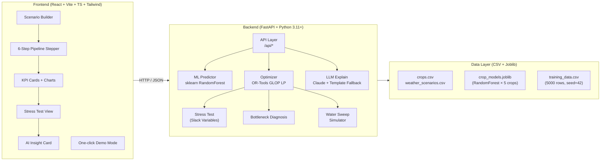

# AquaShift

> **Plan crops. Balance water. Protect livelihoods.**

AquaShift is a water-constrained crop planning and diversification simulator for the **Zinnovatio 4.0 hackathon, AgriTech track**. Team: **NullPointers**.

> ⚠️ **Synthetic Demo Data** — All numbers are calibrated to public agri-statistics (ICAR, CACP, FAO) but are **indicative only** and must not be used for real farming decisions.

---

## Architecture



**Core principle:** ML predicts → Optimization decides → AI explains. The LLM never computes or invents numbers.

---

## Quick Start

### Prerequisites
- Python 3.11+
- Node.js 18+

### Setup & Run

```bash
# 1. Clone and enter the repo
cd AquaShift

# 2. Create virtualenv and install Python deps
python -m venv .venv
# Windows:
.venv\Scripts\activate
# macOS/Linux:
source .venv/bin/activate

pip install -r requirements.txt

# 3. Generate synthetic data and train models
python scripts/generate_data.py
python scripts/train_model.py

# 4. Install frontend deps
cd frontend && npm install && cd ..

# 5. Start both servers (cross-platform)
python scripts/dev.py
```

- **Backend API:** http://localhost:8000 (OpenAPI docs: http://localhost:8000/docs)
- **Frontend:** http://localhost:5173

### CLI Demo (works fully offline, no LLM key needed)

```bash
python scripts/run_demo.py
```

---

## Running Tests

```bash
$env:PYTHONPATH = "backend;scripts"   # Windows
export PYTHONPATH=backend:scripts     # macOS/Linux

python -m pytest backend/tests/ -v
```

All 27 tests should pass.

---

## API Endpoints

| Method | Path | Description |
|--------|------|-------------|
| GET | `/api/health` | Health check |
| GET | `/api/config` | App config (crops, scenarios, region) |
| GET | `/api/baseline` | Baseline paddy-heavy plan |
| POST | `/api/predict` | ML yield + water predictions |
| POST | `/api/optimize` | Run crop allocation optimizer |
| POST | `/api/stress-test` | Extreme scenario + bottleneck diagnosis |
| POST | `/api/explain` | AI/template explanation |
| POST | `/api/simulate/sweep` | Water sensitivity sweep |

---

## Data

All data is **synthetic, seeded (seed=42), and reproducible**:

| File | Description |
|------|-------------|
| `data/crops.csv` | 5 crops: yield, water, cost, price, Ky |
| `data/weather_scenarios.csv` | 4 rainfall scenarios |
| `data/training_data.csv` | Generated by `scripts/generate_data.py` |
| `data/ASSUMPTIONS.md` | Full list of every assumed number |
| `models/crop_models.joblib` | Trained RandomForest models |

---

## Limitations (Honest)

1. **Synthetic data** — Numbers are calibrated to public statistics (ICAR, CACP, FAO) but are not district-level ground truth.
2. **Single-season model** — Does not capture multi-season rotation benefits or soil health dynamics.
3. **Continuous LP** — Crop areas are continuous (fractional hectares). Real farms have discrete, fixed fields.
4. **ML model scope** — RandomForest trained on simplified FAO yield-response relationships. Real yield depends on variety, sowing date, pest pressure, etc.
5. **No price volatility** — Uses fixed MSP/market prices; real prices fluctuate.
6. **Not a substitute for agronomic advice** — This is a decision-support tool, not a prescription.

---

## Roadmap: "Next Steps with Real Data"

| Step | Action |
|------|--------|
| 1 | Plug in real district-level data via `data/loaders/` stubs (ICAR, CGWB, IMD, Agmarknet) |
| 2 | Add multi-season rotation constraints and soil-health variables |
| 3 | Integrate satellite-derived ET and NDVI for real water-stress estimation |
| 4 | Expand to MIP for discrete field-level allocation |
| 5 | Add price volatility scenarios using APEDA market data |
| 6 | Pilot with a real FPO in water-stressed Punjab/Haryana district |

---

## Environment Variables

Copy `.env.example` to `.env`:

```
ANTHROPIC_API_KEY=sk-...    # Optional — app works fully offline without it
ANTHROPIC_MODEL=claude-sonnet-4-20250514
```

---

*AquaShift · Team NullPointers · Zinnovatio 4.0 · AgriTech Track*  
*Synthetic demo data calibrated to public agri statistics — not for real planning decisions.*
